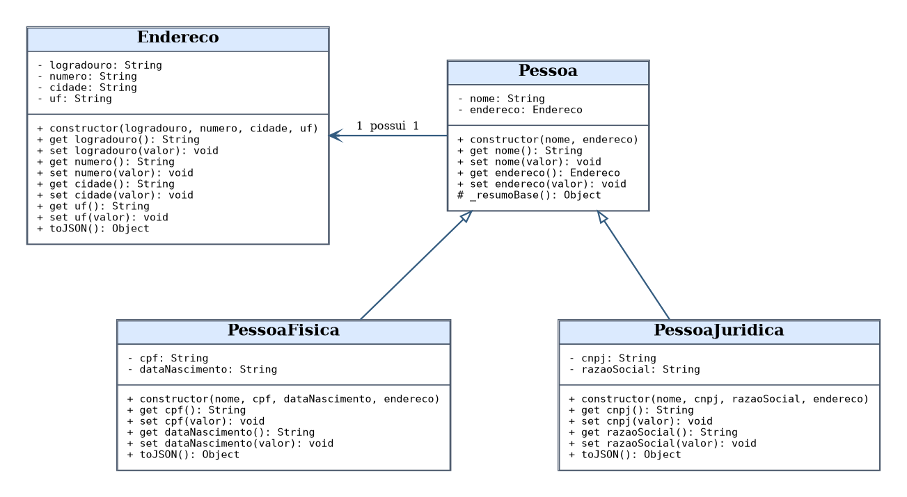

# Electronic - Cadastro de Clientes

**Atividade 01 - Cadastro de Clientes da Electronic: da Modelagem ao Código**

**Estudante:** Makgregor Alves Altê  
**Instituição:** SENAI  
**Unidade curricular:** Programação Orientada a Objetos  
**Linguagem:** JavaScript (Node.js)  
**Local e ano:** Rio Grande - RS, 2026

## 1. Objetivo

Implementar o cadastro de pessoas físicas e jurídicas para um comércio eletrônico, com reaproveitamento de atributos por herança, encapsulamento dos dados, validação das entradas e tratamento de exceções. Somente cadastros válidos são armazenados na lista de clientes.

## 2. Diagrama de classes



O diagrama também está disponível no formato editável do Draw.io: [`docs/diagrama-classes.drawio`](docs/diagrama-classes.drawio).

- **`Endereco`:** logradouro, número, cidade e UF.
- **`Pessoa`:** classe base para os atributos compartilhados de nome e endereço.
- **`PessoaFisica`:** herda de `Pessoa` e acrescenta CPF e data de nascimento.
- **`PessoaJuridica`:** herda de `Pessoa` e acrescenta CNPJ e razão social.

A visibilidade indicada no diagrama utiliza `-` para atributos privados, `+` para operações públicas e `#` para operação destinada às subclasses. Os campos privados são declarados com `#` no JavaScript. O método `_resumoBase()` utiliza a convenção de prefixo `_`, pois a linguagem não possui o modificador `protected`.

## 3. Organização dos arquivos

```text
electronic-cadastro-clientes/
├── index.js
├── package.json
├── src/
│   ├── Endereco.js
│   ├── Pessoa.js
│   ├── PessoaFisica.js
│   └── PessoaJuridica.js
├── docs/
│   ├── diagrama-classes.drawio
│   ├── diagrama-classes.png
│   ├── Atividade_01.pdf
│   └── Atividade_01.docx
└── README.md
```

## 4. Execução

Com o **Node.js** instalado, abra um terminal na pasta principal do projeto e execute:

```bash
node index.js
```

O programa usa recursos nativos do Node.js e não exige dependências externas.

## 5. Regras de validação

| Campo | Regra aplicada |
| --- | --- |
| Nome | Pelo menos três caracteres, desconsiderando espaços externos. |
| CPF | Exatamente 11 dígitos, ignorando pontos, hífen, barra e espaços. |
| CNPJ | Exatamente 14 dígitos, ignorando a pontuação. |
| Data de nascimento | Data existente, no formato `AAAA-MM-DD`, não posterior ao dia atual. |
| Razão social | Preenchimento obrigatório. |
| Endereço | Logradouro, número e cidade preenchidos; UF com duas letras. |

A verificação de CPF e CNPJ segue a exigência de quantidade de dígitos estabelecida no enunciado; não realiza o cálculo de dígitos verificadores. Os setters lançam erros com `throw` quando necessário. Em `index.js`, o bloco `try/catch` registra a mensagem e permite que a próxima tentativa seja processada.

## 6. Evidências de execução

Foram executados os quatro cenários solicitados: pessoa física válida, pessoa jurídica válida, pessoa física com CPF inválido e pessoa jurídica sem razão social. Saída obtida com `node index.js`:

```text
Cenário 1 - Pessoa física válida: CADASTRADO
Cenário 2 - Pessoa jurídica válida: CADASTRADO
Cenário 3 - Pessoa física inválida (CPF): ERRO - CPF deve conter exatamente 11 dígitos.
Cenário 4 - Pessoa jurídica inválida (razão social): ERRO - Razão social é obrigatória.

=== CLIENTES VÁLIDOS CADASTRADOS ===
[
  {
    "tipo": "Pessoa Física",
    "nome": "Ana Souza",
    "endereco": {
      "logradouro": "Rua das Flores",
      "numero": "120",
      "cidade": "Rio Grande",
      "uf": "RS"
    },
    "cpf": "12345678901",
    "dataNascimento": "2000-03-15"
  },
  {
    "tipo": "Pessoa Jurídica",
    "nome": "Electronic",
    "endereco": {
      "logradouro": "Avenida Brasil",
      "numero": "500",
      "cidade": "Porto Alegre",
      "uf": "RS"
    },
    "cnpj": "12345678000190",
    "razaoSocial": "Electronic Comércio de Eletrônicos Ltda."
  }
]

Total de clientes válidos: 2
```

Ao final, a lista contém **dois clientes válidos**. As duas entradas inconsistentes foram recusadas sem interromper a execução.

## 7. Documento da atividade

O registro acadêmico da análise, da modelagem, da implementação e dos resultados está disponível em [`docs/Atividade_01.pdf`](docs/Atividade_01.pdf) e na versão editável [`docs/Atividade_01.docx`](docs/Atividade_01.docx).
